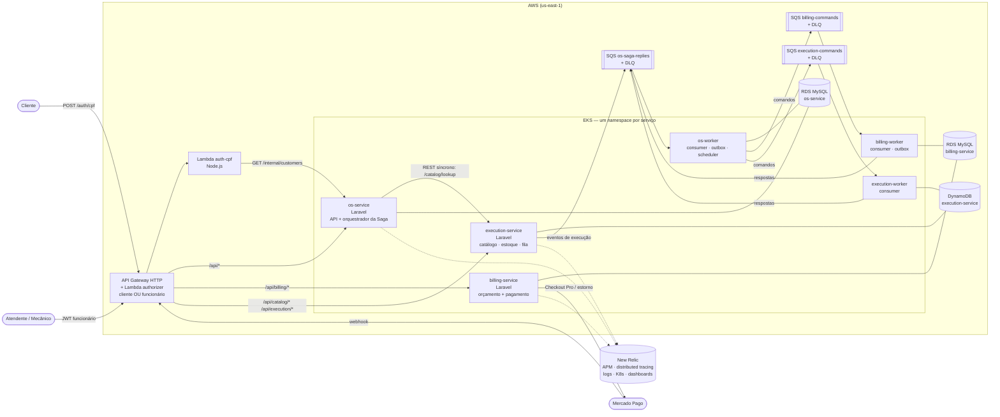

# Arquitetura — Fase 4 (microsserviços)

## Visão geral

**Regra de ouro:** nenhum serviço acessa o banco de outro. A Lambda de CPF, que na Fase 3 lia o MySQL do os-service, agora usa o endpoint interno `GET /api/internal/customers/by-document/{cpf}`, protegido por `X-Internal-Token`.

## Divisão dos microsserviços e justificativa

| Serviço | Responsabilidade (bounded context) | Banco | Por quê |
|---|---|---|---|
| **os-service** (`tech-challenge-fiap`) | Clientes, veículos, OS (abertura, status, histórico), notificações, autenticação de funcionários, **orquestrador da saga** | **MySQL** (RDS) | É o "dono" da OS e do relacionamento com o cliente. Os dados são relacionais (cliente → veículos → OS), e o outbox exige transação ACID junto com o estado da saga. |
| **billing-service** | Orçamento (geração, aprovação/recusa), pagamento via **Mercado Pago**, estorno | **MySQL** (RDS próprio) | Dinheiro exige consistência forte e auditoria. Orçamento/pagamento/outbox gravados atomicamente. Isola o acoplamento com o provedor de pagamento. |
| **execution-service** | Catálogo de serviços e peças, estoque, fila de execução, diagnóstico/reparo, métricas de tempo | **DynamoDB** (NoSQL) | Acesso por chave (OS, peça) e por índice (status, código), escrita intensa e sem joins. A reserva de estoque usa `TransactWriteItems` condicional. Escala sem gerenciar instâncias. |

A divisão segue as áreas citadas no desafio: atendimento → os-service; cobrança → billing; diagnóstico e execução → execution. Cada área pode evoluir e escalar de forma independente.

## Comunicação

| Tipo | Onde | Por quê |
|---|---|---|
| **REST síncrono** | os-service → execution-service `POST /api/catalog/lookup` ao abrir a OS (repassando o JWT do funcionário) | O atendente precisa da resposta na hora: o item existe? Qual o preço? Se o catálogo estiver fora, responde 503 e nada é gravado. |
| **REST síncrono** | Lambda → os-service `GET /api/internal/customers/by-document` | Autenticação por CPF é uma consulta pontual com resposta imediata. |
| **Mensageria assíncrona (SQS)** | Todos os passos da saga (comandos e respostas) | Desacoplamento temporal: um serviço fora do ar não derruba o fluxo, as mensagens esperam na fila. Habilita retries, DLQ e compensações. |

Contrato das mensagens: [contratos-mensagens.md](contratos-mensagens.md). Detalhes da saga: [adrs/001-saga-orquestrada.md](adrs/001-saga-orquestrada.md) e [diagrama-saga.md](diagrama-saga.md).

## Tecnologias

| Tecnologia | Uso | Justificativa |
|---|---|---|
| PHP 8.4 / Laravel 13 (DDD) | Os 3 serviços | Reaproveita o domínio e as camadas DDD das fases anteriores e o conhecimento do time; uma stack só simplifica CI/CD e observabilidade. |
| Amazon EKS + Terraform | Deploy de cada serviço (namespace próprio, HPA, NLB) | Continuidade da Fase 3; infraestrutura como código por repositório. |
| Amazon SQS (+ DLQ) | Mensageria da saga | Gerenciado, funciona com a LabRole do Academy, DLQ nativa. |
| RDS MySQL ×2, DynamoDB | Um banco por serviço (SQL + NoSQL) | Requisito da fase; a escolha por serviço está justificada na tabela acima. |
| Mercado Pago (Checkout Pro + webhook + refunds) | Pagamento e estorno | Requisito da fase. O webhook é validado por `x-signature` (HMAC) e o pagamento é sempre reconsultado na API. |
| API Gateway + Lambda authorizer | Porta de entrada única | Continuidade da Fase 3, agora roteando para os 3 serviços e aceitando token de cliente ou de funcionário. |
| New Relic | APM, distributed tracing, logs, K8s, dashboards | Ferramenta da Fase 3 (exigência), agora **ligada por padrão**. Os headers de trace viajam nas mensagens SQS, então um único trace cobre os 3 serviços. |
| PHPUnit + Behat + SonarCloud | Qualidade | Testes unitários/integração com cobertura ≥ 80% (gate no CI), BDD do fluxo completo e quality gate do Sonar em cada PR. |
| GitHub Actions | CI/CD independente por repositório | Lint → testes + cobertura → BDD → Sonar → build → GHCR → `terraform apply` no EKS. `main` protegida com PR e checks obrigatórios. |

## Repositórios

| Repositório | Conteúdo |
|---|---|
| [`tech-challenge-fiap`](https://github.com/VinnyTechDevelopment/tech-challenge-fiap) | os-service (orquestrador) |
| [`billing-service-fiap`](https://github.com/VinnyTechDevelopment/billing-service-fiap) | billing-service |
| [`execution-service-fiap`](https://github.com/VinnyTechDevelopment/execution-service-fiap) | execution-service |
| [`lambda-auth-cpf-fiap`](https://github.com/VinnyTechDevelopment/lambda-auth-cpf-fiap) | API Gateway, Lambda de CPF e authorizer |
| [`infra-kubernetes-fiap`](https://github.com/VinnyTechDevelopment/infra-kubernetes-fiap) | VPC, EKS e integração New Relic do cluster |
| [`infra-database-fiap`](https://github.com/VinnyTechDevelopment/infra-database-fiap) | RDS do os-service |
