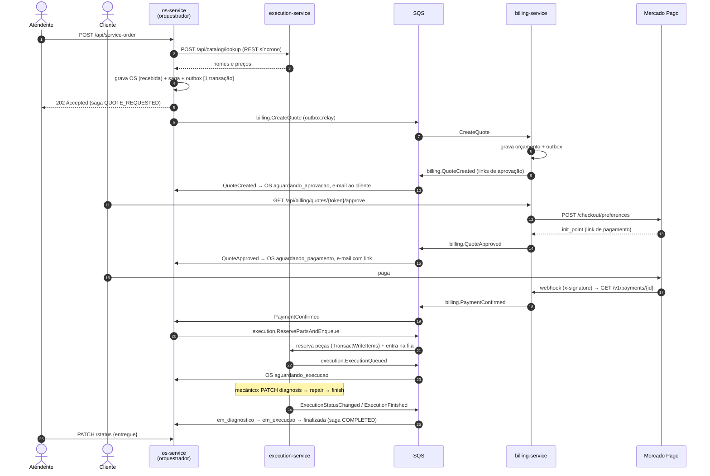
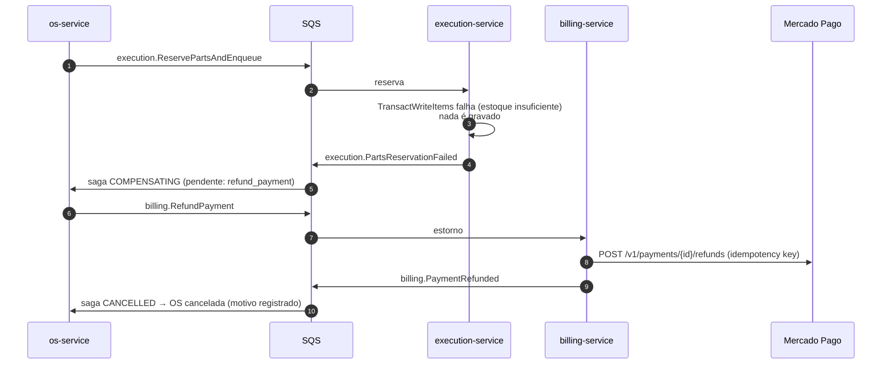
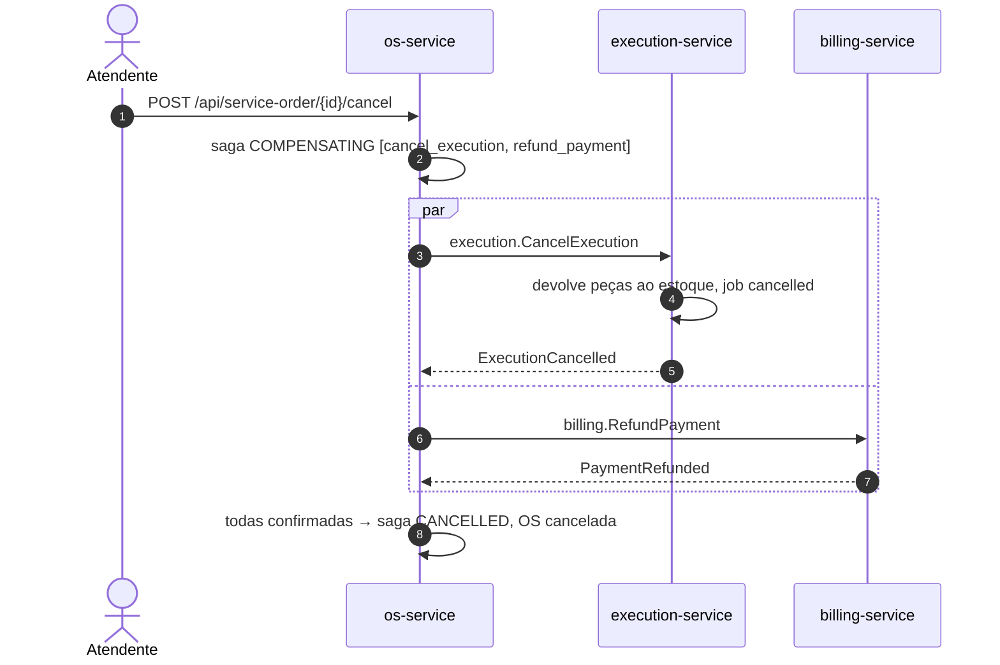

# Saga da Ordem de Serviço — diagramas de sequência

## Caminho feliz

## Compensação: sem peças em estoque (estorno)

## Compensação: cancelamento durante a execução (duas compensações em paralelo)

## Outras falhas tratadas

- **Orçamento recusado / falha ao gerar orçamento:** OS cancelada sem compensação (nada a desfazer).
- **Pagamento recusado ou prazo expirado** (`saga:timeouts`, a cada minuto): `CancelQuote` e, após confirmação, OS cancelada.
- **Pagamento aprovado depois da compensação:** o billing estorna automaticamente e envia `PaymentRefunded{late_payment: true}`, registrado no histórico.
- **Estorno recusado pelo provedor:** saga `FAILED`, evento `SagaCompensationFailed` no New Relic para ação manual.
